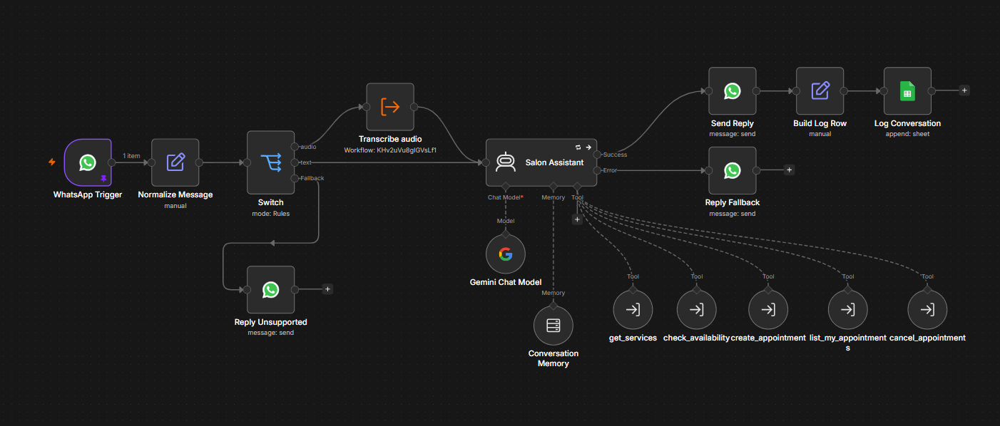
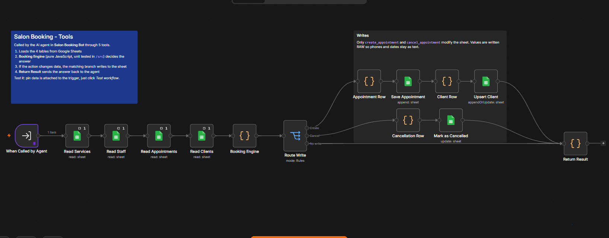
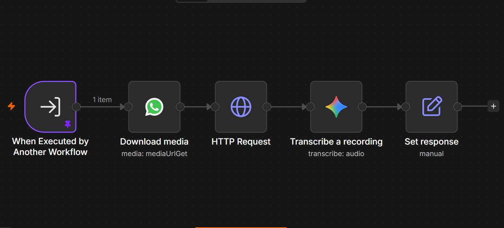

🇬🇧 [Read in English](README.md)

# Glow Studio – Asistente de turnos por WhatsApp

Una recepcionista con IA para un salón de belleza que reserva, lista y cancela turnos por **WhatsApp**, construida con **n8n**, **Google Gemini** y **Google Sheets** como base de datos.

Los clientes escriben o mandan una **nota de voz** en lenguaje natural (*"¿Tenés algo para un corte el martes que viene a la tarde?"*). El asistente consulta la disponibilidad real, confirma los datos, guarda el turno y responde con un código de reserva. Contesta en el idioma del cliente (español o inglés).

> Glow Studio es un negocio ficticio. Todos los nombres, teléfonos y datos de este repositorio son inventados.

<!-- Agregá una grabación de pantalla cuando la tengas, por ejemplo  -->

---

## Funcionalidades

- **Reservas en lenguaje natural** con un agente de IA basado en Gemini y memoria de conversación por cliente
- **Soporte para notas de voz**: los audios se descargan de WhatsApp, se transcriben con Gemini y se procesan igual que un texto
- **Motor de disponibilidad real**: horarios de cada estilista, días laborales, duración de los servicios, detección de superposiciones, anticipación mínima y ventana de reservas
- **Autogestión**: los clientes pueden ver y cancelar sus propios turnos
- **Reglas de negocio aplicadas en código, no en el prompt**: la IA no puede reservar un horario ocupado, reservar en el pasado ni cancelar el turno de otra persona
- **Google Sheets como base de datos liviana** que el personal del salón puede leer y editar directamente
- **Registro de conversaciones** para auditoría y análisis
- **Lógica de negocio con tests unitarios** (`npm test`), escrita en JavaScript plano en `/src`

## Arquitectura





```text
WhatsApp Trigger
   └─> Normalize Message (Set)
          └─> Switch según el tipo de mensaje
                 ├─ text  ───────────────────────────────┐
                 ├─ audio ─> Transcribe audio (sub-wf) ──┤
                 │                                        └─> Salon Assistant (Gemini + memoria + 5 tools)
                 │                                               ├─ ok    ─> Send Reply ─> Build Log Row ─> Log Conversation
                 │                                               └─ error ─> Reply Fallback
                 └─ otro (imagen, sticker, ubicación…) ─> Reply Unsupported
```

El proyecto está dividido en **tres workflows**:

| Workflow | Función |
|---|---|
| **Salon Booking Bot** | Recibe los mensajes de WhatsApp, los deriva según su tipo, ejecuta el agente de IA y envía la respuesta. |
| **Transcribe audio** | Descarga la nota de voz desde la API de Media de WhatsApp, la transcribe con Gemini y devuelve la misma estructura que un mensaje de texto. |
| **Salon Booking - Tools** | El único workflow que accede a la base de datos. Todas las tools del agente pasan por su **Booking Engine**. |

**¿Por qué separar las tools?** El agente de IA decide *qué* hacer; el sub-workflow de tools decide *si está permitido* y hace las lecturas y escrituras. Cada llamada pasa por el mismo **Booking Engine** determinístico, así que una respuesta inesperada del modelo no puede saltearse las reglas de negocio.

**¿Por qué un sub-workflow aparte para los audios?** Devuelve exactamente los mismos campos que un mensaje de texto, con la transcripción en `text`. Al agente no le importa si el cliente escribió o habló, así que hay un solo agente, un solo prompt y un solo conjunto de tools para mantener. Se pueden sumar nuevos tipos de entrada (por ejemplo, imágenes) de la misma forma: una salida más en el Switch y un sub-workflow más.

**Detalle de seguridad:** el número del cliente lo inyecta el workflow desde el webhook de WhatsApp; nunca lo elige la IA. Un cliente solo puede ver o cancelar sus propios turnos, aunque le pida al bot los de otra persona.

### Formato del mensaje

`Normalize Message` convierte el payload del webhook en un objeto plano. Tanto la rama de texto como la de audio le entregan al agente esta misma estructura:

| Campo | Origen | Notas |
|---|---|---|
| `phone` | `contacts[0].wa_id` | Identidad del cliente: se usa para la memoria, las tools y el registro. |
| `replay_to` | `contacts[0].wa_id` | Destinatario de la respuesta. Está separado de `phone` para poder cambiarle el formato sin alterar la identidad del cliente (ver Solución de problemas). |
| `profile_name` | `contacts[0].profile.name` | Nombre visible en WhatsApp. |
| `type` | `messages[0].type` | `text`, `audio`, `image`, … Define la salida del Switch. |
| `text` | `messages[0].text.body` | `null` en los audios. **Transcribe audio** lo completa con la transcripción. |
| `message_id` | `messages[0].id` | |
| `phone_number_id` | `metadata.phone_number_id` | Tu número de WhatsApp Business, usado para enviar la respuesta. |
| `audio_id` | `messages[0].audio.id` | ID del archivo para descargar la nota de voz. `null` en cualquier mensaje que no sea audio. |

### Tools del agente

| Tool | Lo que aporta la IA | Lo que inyecta el workflow | Escribe en la hoja |
|---|---|---|---|
| `get_services` | – | – | No |
| `check_availability` | servicio, fecha, estilista (opcional) | – | No |
| `create_appointment` | servicio, fecha, hora, estilista (opcional), nombre | teléfono, nombre de WhatsApp | `Appointments`, `Clients` |
| `list_my_appointments` | – | teléfono | No |
| `cancel_appointment` | código del turno | teléfono | `Appointments` |

## Modelo de datos (Google Sheets)

Una planilla con cinco pestañas. Los nombres de las pestañas y de los encabezados tienen que coincidir exactamente.

| Pestaña | Columnas | Propósito |
|---|---|---|
| **Services** | `service_id`, `name`, `category`, `duration_min`, `price`, `active` | Catálogo. Poné `active` en `FALSE` para ocultar un servicio. |
| **Staff** | `staff_id`, `name`, `service_ids`, `work_days`, `start_time`, `end_time`, `active` | Estilistas. `service_ids` tipo `S01,S03`; `work_days` tipo `Tue-Sat` o `Mon,Wed,Fri`. |
| **Clients** | `phone`, `name`, `created_at`, `last_booking_at`, `total_bookings` | Una fila por cliente; se crea o actualiza en cada reserva. |
| **Appointments** | `appointment_id`, `phone`, `client_name`, `service_id`, `service_name`, `staff_id`, `staff_name`, `date`, `start_time`, `end_time`, `price`, `status`, `channel`, `created_at`, `updated_at` | Turnos. `status`: `booked`, `cancelled`, `completed`, `no_show`. |
| **MessageLog** | `timestamp`, `phone`, `profile_name`, `message_type`, `incoming_text`, `bot_reply` | Cada mensaje procesado y la respuesta del bot. `message_type` es `text` o `audio`; en las notas de voz, `incoming_text` guarda la transcripción. |

`Appointments` está **desnormalizada** a propósito (guarda los nombres del servicio y del estilista, no solo los IDs). El personal puede leerla sin cruzar tablas, y se conecta directo a Looker Studio o a una tabla dinámica.

La plantilla trae 8 servicios, 3 estilistas, 12 clientes y ~290 turnos (octubre–noviembre de 2026), para que la disponibilidad se vea realista y los datos estén listos para un dashboard. Los estados `completed` y `no_show` los actualiza el personal del salón.

### Reglas de negocio

Se configuran al principio de [`src/booking-engine.js`](src/booking-engine.js):

| Regla | Valor por defecto |
|---|---|
| Zona horaria | `America/Argentina/Buenos_Aires` |
| Horarios de inicio ofrecidos | cada 30 min |
| Anticipación mínima para reservar | 60 min |
| Ventana de reservas | 30 días |
| Cancelación permitida hasta | 2 h antes del turno |

## Estructura del repositorio

```text
├── assets/                         # Capturas de los workflows usadas en este README
├── workflows/
│   ├── salon-booking-bot.json      # Workflow principal: WhatsApp + ruteo + agente de IA (importar en n8n)
│   ├── transcribe-audio.json       # Sub-workflow: descarga y transcripción de notas de voz (importar en n8n)
│   └── salon-booking-tools.json    # Sub-workflow: booking engine + Google Sheets (importar en n8n)
├── sheets/
│   ├── salon-booking-db-template.xlsx   # Plantilla de la base de datos con datos de ejemplo
│   └── csv/                              # Los mismos datos en CSV, un archivo por pestaña
├── src/
│   ├── booking-engine.js           # Lógica de negocio (se inserta en el nodo Code "Booking Engine")
│   └── system-prompt.md            # Instrucciones del agente de IA
├── scripts/
│   ├── build-workflows.js          # Regenera salon-booking-tools.json a partir de src/booking-engine.js
│   └── generate-sample-data.py     # Regenera la planilla de ejemplo
└── tests/
    └── booking-engine.test.js      # Tests unitarios (test runner nativo de Node)
```

La lógica de reservas vive en `/src` y se inserta en el nodo **Booking Engine** de `salon-booking-tools.json`. Para modificarla, editá `src/booking-engine.js`, ejecutá `npm run build` y volvé a importar el workflow de tools. `salon-booking-bot.json` y `transcribe-audio.json` se exportan directamente desde n8n.

---

## Instalación

### Requisitos

- n8n corriendo en local (Docker o npm), versión 1.80 o superior recomendada
- Una app de Meta for Developers con **WhatsApp Cloud API** y un número de prueba
- Una **API key de Google Gemini** ([Google AI Studio](https://aistudio.google.com/)), que se usa tanto para el chat como para transcribir audios
- Una cuenta de Google para Sheets
- [ngrok](https://ngrok.com/) para exponer tu n8n local a los webhooks de Meta

### 1. Crear la base de datos

1. Creá una Google Sheet nueva y andá a **Archivo → Importar → Subir**, elegí `sheets/salon-booking-db-template.xlsx` y seleccioná **Reemplazar hoja de cálculo**.
2. Verificá que existan las cinco pestañas: `Services`, `Staff`, `Clients`, `Appointments`, `MessageLog`.
3. Copiá el ID de la planilla desde la URL:
   `https://docs.google.com/spreadsheets/d/`**`ESTA_PARTE_ES_EL_ID`**`/edit`

### 2. Importar el sub-workflow de tools

1. Abrí `workflows/salon-booking-tools.json` en un editor de texto y reemplazá cada `REPLACE_WITH_YOUR_SPREADSHEET_ID` por el ID de tu planilla (Buscar y reemplazar todo).
2. En n8n: **Create workflow → menú ⋯ → Import from File** → elegí el archivo editado.
3. Abrí cada nodo de Google Sheets (son 7) y seleccioná tu credencial de **Google Sheets**.
4. **Guardá** y copiá el ID de este workflow desde la URL del navegador:
   `http://localhost:5678/workflow/`**`ESTE_ES_EL_ID_DEL_WORKFLOW`**
5. Hacé clic en **Test workflow**. El trigger tiene datos de ejemplo fijados (`check_availability` para un corte). **Return Result** debería mostrar horarios libres.

### 3. Importar el sub-workflow de audio

1. Importá `workflows/transcribe-audio.json` de la misma forma.
2. Seleccioná las credenciales:

   | Nodo | Tipo de credencial |
   |---|---|
   | Download media | WhatsApp API (Access Token + Business Account ID) |
   | HTTP Request | WhatsApp API (*Authentication → Predefined Credential Type*) |
   | Transcribe a recording | Google Gemini (PaLM) API |

3. **Guardá** y copiá el ID de este workflow desde la URL, como en el paso 2.4.

Cómo funciona: **Download media** le pide a la API de WhatsApp una URL temporal para el `audio_id`, **HTTP Request** descarga el archivo (la URL requiere tu token de WhatsApp), **Transcribe a recording** le envía el audio a Gemini y **Set response** devuelve los campos originales del mensaje con `text` reemplazado por la transcripción.

### 4. Importar el workflow principal del bot

1. Abrí `workflows/salon-booking-bot.json` en un editor de texto y reemplazá:
   - `REPLACE_WITH_TOOLS_WORKFLOW_ID` (5 veces) → el ID del paso 2.4
   - `REPLACE_WITH_TRANSCRIBE_WORKFLOW_ID` (1 vez) → el ID del paso 3.3
   - `REPLACE_WITH_YOUR_SPREADSHEET_ID` (1 vez) → el ID de tu planilla
2. Importalo de la misma forma.
3. Seleccioná las credenciales:

   | Nodo | Tipo de credencial |
   |---|---|
   | WhatsApp Trigger | WhatsApp OAuth API (App ID + App Secret) |
   | Send Reply, Reply Fallback, Reply Unsupported | WhatsApp API (Access Token + Business Account ID) |
   | Gemini Chat Model | Google Gemini (PaLM) API |
   | Log Conversation | Google Sheets |

4. En **Gemini Chat Model**, revisá el modelo. El predeterminado es `gemini-2.5-flash`; si no aparece en la lista, elegí el modelo *Flash* más nuevo (rápido y barato es lo ideal para un chat). Hacé lo mismo en **Transcribe a recording**.

### 5. Exponer n8n con ngrok

Meta solo puede enviar webhooks a una URL pública con HTTPS.

```bash
# Un dominio estático gratuito evita tener una URL nueva en cada reinicio:
# https://dashboard.ngrok.com/domains
ngrok http --url=tu-nombre.ngrok-free.app 5678
```

Después indicale a n8n su URL pública y reinicialo:

```bash
# Docker
docker run -it --rm -p 5678:5678 \
  -e WEBHOOK_URL=https://tu-nombre.ngrok-free.app/ \
  -e GENERIC_TIMEZONE=America/Argentina/Buenos_Aires \
  -v n8n_data:/home/node/.n8n docker.n8n.io/n8nio/n8n

# npm (macOS / Linux)
export WEBHOOK_URL=https://tu-nombre.ngrok-free.app/
n8n start
```

Abrí el nodo **WhatsApp Trigger**: las URLs del webhook ahora deberían empezar con tu dominio de ngrok.

### 6. Desactivar las actualizaciones de estado en el trigger

WhatsApp envía un webhook no solo por cada mensaje, sino también por cada cambio de estado (*enviado*, *entregado*, *leído*). Cada uno inicia una ejecución, lo que gasta lecturas de Google Sheets y puede provocar límites de uso.

Abrí **WhatsApp Trigger → Options → Receive Message Status Updates** y quitá **All** para que solo lleguen mensajes reales.

### 7. Publicar los tres workflows

Publicalos (o activá **Active** en versiones anteriores de n8n) en este orden:

1. Primero **Salon Booking - Tools** y **Transcribe audio**. El workflow principal llama a la versión *publicada* de cada sub-workflow, no al borrador.
2. Después **Salon Booking Bot**. El WhatsApp Trigger registra su webhook en tu app de Meta automáticamente.

> Una app de Meta tiene **una sola** URL de webhook. Al activar este workflow se reemplaza la URL que estuvieran usando otros bots en la misma app.

---

## Cómo probarlo

### Tests unitarios (no necesitan n8n)

```bash
npm test
```

Ejecuta el booking engine con datos de ejemplo fijos: disponibilidad, superposiciones, anticipación mínima, fechas pasadas o lejanas, reservas, control de titularidad y reglas de cancelación.

### Guion de conversación

Mandá estos mensajes desde tu número de prueba de WhatsApp (en español o inglés):

| # | Mensaje | Resultado esperado |
|---|---|---|
| 1 | `¡Hola! ¿Qué servicios tienen?` | Catálogo con precios. Llama a `get_services`. |
| 2 | `Quiero un corte de pelo de mujer el martes que viene` | 3–4 opciones de horario. Llama a `check_availability`. |
| 3 | `A las 11:00, por favor` | Resumen del turno; pide confirmación y tu nombre. |
| 4 | `Sí, soy Ana Pérez` | Confirmación con un código `APT-…`. Filas nuevas en **Appointments** y **Clients**. |
| 5 | `¿Qué turnos tengo?` | Lista el turno del paso 4. |
| 6 | `Cancelalo, por favor` | Pregunta cuál o confirma, y lo cancela. `status` pasa a `cancelled`. |
| 7 | `¿Puedo reservar un balayage este domingo?` | Explica que está cerrado y propone la próxima fecha disponible. |
| 8 | Una nota de voz: *"¿Tienen algo para manicura mañana?"* | Mismo comportamiento que la versión en texto. La ejecución de **Transcribe audio** muestra la transcripción; **MessageLog** recibe una fila con `message_type = audio`. |
| 9 | Una foto o un sticker | Respuesta de **Reply Unsupported** indicando que solo acepta texto o audio. |
| 10 | `Cancelá el APT-261110-XXXX` (código de otra persona) | No encontrado. Se respeta la titularidad. |

Después de cada mensaje, la pestaña **Executions** de n8n muestra cada llamada a las tools con su entrada y salida exactas. Es la mejor forma de entender qué está haciendo el agente.

### Probar los sub-workflows por separado

- **Salon Booking - Tools**: editá los datos fijados en **When Called by Agent** (por ejemplo, cambiá `action` a `get_services` o `create_appointment`) y hacé clic en **Test workflow**. Los datos fijados solo se usan en ejecuciones manuales.
- **Transcribe audio**: abrí una ejecución exitosa de un audio en el workflow principal, copiá la salida de **Normalize Message**, fijala en **When Executed by Another Workflow** y hacé clic en **Test workflow**. Los IDs de archivos de WhatsApp vencen después de un tiempo, así que usá una nota de voz reciente.

---

## Solución de problemas

| Síntoma | Causa probable y solución |
|---|---|
| Los mensajes llegan pero las respuestas fallan con *recipient not in allowed list* (error 131030) | Los celulares argentinos llegan como `549…`, pero la lista de números permitidos de prueba puede usar `54…`. En **Normalize Message**, cambiá la expresión de `replay_to` por `{{ $json.contacts[0].wa_id.replace(/^549/, '54') }}`. `phone` no cambia, así que la memoria y los turnos siguen funcionando. Para otros países, revisá el formato del número en la lista de permitidos. |
| No llega nada a n8n | `WEBHOOK_URL` no está configurada o n8n no se reinició. El workflow tiene que estar publicado/activo, ngrok tiene que estar corriendo y la URL del trigger tiene que mostrar el dominio de ngrok. |
| El webhook dejó de funcionar después de reiniciar ngrok | Sin un dominio estático, la URL cambia. Usá un dominio estático, o actualizá `WEBHOOK_URL` y volvé a activar el workflow. |
| *Workflow does not exist* en una tool o en **Transcribe audio** | No se reemplazó algún placeholder `REPLACE_WITH_…_WORKFLOW_ID`. Abrí el nodo y elegí el workflow correcto de la lista. |
| Un nodo de tool muestra una advertencia y no se puede publicar el workflow | Algunas versiones de n8n exigen el campo **Name** de la tool. Completalo con el nombre del nodo (`get_services`, `check_availability`, …). |
| El bot dice que "tiene problemas para acceder al catálogo" | Falló una llamada a una tool. Verificá que **Salon Booking - Tools** esté publicado y que todos los nodos de Google Sheets tengan credencial. Revisá **Salon Booking - Tools → Executions** para encontrar el nodo en rojo. |
| Las notas de voz no reciben respuesta | Revisá **Transcribe audio → Executions**. *401* en **HTTP Request**: falta la credencial de WhatsApp o venció (los tokens de prueba duran 24 h). Transcripción vacía: revisá el modelo de Gemini en **Transcribe a recording**. |
| Muchas ejecuciones por mensaje, o Gemini *429 Too Many Requests* | Están llegando actualizaciones de estado al trigger (ver el paso 6). Además, cada llamada a una tool y cada transcripción es un pedido más a Gemini, y el plan gratuito tiene límites bajos por minuto y por día. Esperá a que se renueve la cuota o activá la facturación en Google AI Studio. |
| Gemini *model not found* | Elegí un modelo vigente en **Gemini Chat Model** y en **Transcribe a recording**. Las API keys nuevas pueden no tener acceso a modelos viejos. Usá un modelo *Flash* actual (con soporte de tool calling para el modelo de chat). |
| Las fechas aparecen como números o `10/11/2026` en la planilla | No es un problema. El motor lee fechas ISO, `DD/MM/YYYY` y números de serie de Sheets. Para mantener el orden, poné las columnas de fecha en formato *Texto sin formato*. |
| Google Sheets *429 Too Many Requests* | Cada llamada a una tool lee 4 pestañas. Para demos alcanza; para mucho tráfico, ver la hoja de ruta. |
| El bot "se olvida" de la conversación después de reiniciar n8n | Es lo esperado. *Window Buffer Memory* vive en la memoria del proceso de n8n. Reemplazalo por un nodo de memoria de chat con Postgres o Redis para que persista. |

## Decisiones de diseño

- **Google Sheets como base de datos**: no requiere configuración, se ve en tiempo real durante una demo y la puede editar personal no técnico. Además se conecta directo a Looker Studio.
- **La lógica de negocio en un solo nodo Code en lugar de muchos nodos de n8n**: la disponibilidad es algorítmica (intervalos, superposiciones, horarios). Como código es legible, versionable y tiene tests. n8n se encarga de lo que mejor hace: integraciones, credenciales y orquestación.
- **Tools determinísticas, conversación flexible**: el LLM maneja el lenguaje y el diálogo; el motor es la única autoridad sobre qué se puede reservar.
- **Normalización del mensaje con un nodo Set**: mapear los campos del webhook es una simple extracción de datos, así que un nodo Set lo deja visible y editable desde la interfaz de n8n sin código.
- **Un mismo formato de mensaje para todos los tipos de entrada**: el audio se convierte en texto antes de llegar al agente, así que el agente, su prompt y sus tools no cambian según cómo escriba el cliente.
- **Manejo de fechas en JavaScript plano**: usa `Intl` con una zona horaria explícita, así que el comportamiento no depende de la configuración del reloj del servidor.

## Limitaciones y hoja de ruta

- **Concurrencia**: dos clientes que confirmen exactamente el mismo horario en el mismo segundo podrían reservar los dos, porque Sheets no tiene transacciones. → Migrar a **PostgreSQL** con una restricción única o de exclusión sobre (estilista, rango horario).
- **Manejo de errores en audios**: si falla la descarga o la transcripción, el cliente no recibe respuesta. → Agregar una salida de error en **Transcribe audio** que envíe un mensaje tipo "por favor, escribí tu consulta".
- **Más tipos de entrada**: imágenes (por ejemplo, una foto de referencia para un corte) mediante otro sub-workflow con Gemini vision.
- **Recordatorios**: enviar un recordatorio 24 h antes de cada turno con un workflow programado. Fuera de la ventana de 24 horas de WhatsApp, esto requiere una plantilla de mensaje aprobada.
- **Dashboard**: un reporte de Looker Studio sobre `Appointments` (turnos por día, facturación, tasa de ausentismo, servicios y estilistas más pedidos).
- **Memoria de chat persistente** (Postgres o Redis) y una marca de **derivación a una persona**.
- **Mensajes interactivos de WhatsApp** (botones y listas) para elegir horarios.

## Tecnologías

n8n · n8n AI Agent (LangChain) · Google Gemini (chat + transcripción de audio) · WhatsApp Cloud API (mensajes + media) · Google Sheets API · JavaScript (Node.js) · ngrok