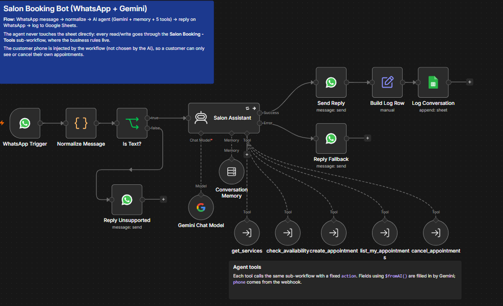
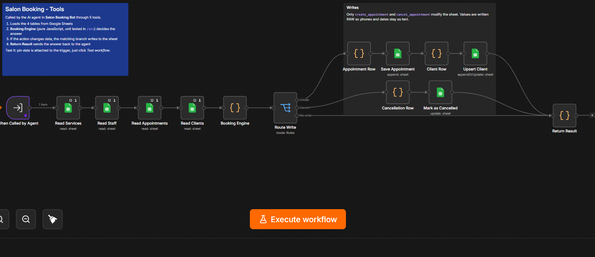

# Glow Studio – WhatsApp Booking Assistant

An AI receptionist for a beauty salon that books, lists and cancels appointments over **WhatsApp**, built with **n8n**, **Google Gemini** and **Google Sheets** as the database.

Customers write in plain language (*"Do you have something for a haircut next Tuesday afternoon?"*). The assistant checks real availability, confirms the details, saves the booking and replies with an appointment code. It answers in the customer's language (Spanish or English).

> Glow Studio is a fictional business. All names, phone numbers and data in this repo are made up.

<!-- Add a screen recording here once you have one, e.g.  -->

---

## Features

- **Natural-language booking** with a Gemini-powered AI agent and per-customer conversation memory
- **Real availability engine**: stylist schedules, working days, service durations, overlap detection, minimum lead time, booking window
- **Self-service**: customers can list and cancel their own appointments
- **Business rules enforced in code, not in the prompt**: the AI can't book a taken slot, book in the past, or cancel someone else's appointment
- **Google Sheets as a lightweight database** the salon staff can read and edit directly
- **Conversation log** for auditing and analytics
- **Unit-tested business logic** (`npm test`), kept as plain JavaScript in `/src`

## Architecture




**Why two workflows?** The AI agent decides *what* to do; the tools sub-workflow decides *whether it's allowed* and does the reads and writes. Every tool call goes through the same deterministic **Booking Engine**, so business rules can't be bypassed by an unexpected answer from the model.

**Security detail:** the customer's phone number is injected by the workflow from the WhatsApp webhook, never chosen by the AI. A customer can only see or cancel their own appointments, even if they ask the bot for someone else's.

### Agent tools

| Tool | What the AI provides | What the workflow injects | Writes to sheet |
|---|---|---|---|
| `get_services` | – | – | No |
| `check_availability` | service, date, stylist (optional) | – | No |
| `create_appointment` | service, date, time, stylist (optional), name | phone, WhatsApp name | `Appointments`, `Clients` |
| `list_my_appointments` | – | phone | No |
| `cancel_appointment` | appointment code | phone | `Appointments` |

## Data model (Google Sheets)

One spreadsheet with five tabs. Tab names and header names must match exactly.

| Tab | Columns | Purpose |
|---|---|---|
| **Services** | `service_id`, `name`, `category`, `duration_min`, `price`, `active` | Catalog. Set `active` to `FALSE` to hide a service. |
| **Staff** | `staff_id`, `name`, `service_ids`, `work_days`, `start_time`, `end_time`, `active` | Stylists. `service_ids` like `S01,S03`; `work_days` like `Tue-Sat` or `Mon,Wed,Fri`. |
| **Clients** | `phone`, `name`, `created_at`, `last_booking_at`, `total_bookings` | One row per customer, upserted on each booking. |
| **Appointments** | `appointment_id`, `phone`, `client_name`, `service_id`, `service_name`, `staff_id`, `staff_name`, `date`, `start_time`, `end_time`, `price`, `status`, `channel`, `created_at`, `updated_at` | Bookings. `status`: `booked`, `cancelled`, `completed`, `no_show`. |
| **MessageLog** | `timestamp`, `phone`, `profile_name`, `message_type`, `incoming_text`, `bot_reply` | Every handled message and the bot's reply. |

`Appointments` is intentionally **denormalized** (it stores service and stylist names, not just IDs). Staff can read it without lookups, and it plugs straight into Looker Studio or a pivot table.

The template ships with 8 services, 3 stylists, 12 clients and ~290 appointments (October–November 2026), so availability looks realistic and the data is ready for a dashboard. `completed` and `no_show` are meant to be updated by salon staff.

### Business rules

Configured at the top of [`src/booking-engine.js`](src/booking-engine.js):

| Rule | Default |
|---|---|
| Time zone | `America/Argentina/Buenos_Aires` |
| Offered start times | every 30 min |
| Minimum notice to book | 60 min |
| Booking window | 30 days ahead |
| Cancellation allowed until | 2 h before the appointment |

## Repository structure

```text
├── workflows/
│   ├── salon-booking-bot.json      # Main workflow: WhatsApp + AI agent (import into n8n)
│   └── salon-booking-tools.json    # Sub-workflow: booking engine + Google Sheets (import into n8n)
├── sheets/
│   ├── salon-booking-db-template.xlsx   # Database template with sample data
│   └── csv/                              # Same data as CSV, one file per tab
├── src/
│   ├── booking-engine.js           # Business logic (embedded into the "Booking Engine" Code node)
│   ├── normalize-message.js        # Webhook parsing (embedded into "Normalize Message")
│   └── system-prompt.md            # AI agent instructions
├── scripts/
│   ├── build-workflows.js          # Regenerates /workflows from /src
│   └── generate-sample-data.py     # Regenerates the sample spreadsheet
└── tests/
    └── booking-engine.test.js      # Unit tests (Node built-in test runner)
```

The JSON files in `/workflows` are **generated**. To change the logic, edit `/src`, run `npm run build`, and re-import.

---

## Setup

### Prerequisites

- n8n running locally (Docker or npm), version 1.80 or newer recommended
- A Meta developer app with **WhatsApp Cloud API** and a test phone number
- A **Google Gemini API key** ([Google AI Studio](https://aistudio.google.com/))
- A Google account for Sheets
- [ngrok](https://ngrok.com/) to expose your local n8n to Meta's webhooks

### 1. Create the database

1. Create a new Google Sheet and go to **File → Import → Upload**, choose `sheets/salon-booking-db-template.xlsx`, and select **Replace spreadsheet**.
2. Check that the five tabs exist: `Services`, `Staff`, `Clients`, `Appointments`, `MessageLog`.
3. Copy the spreadsheet ID from the URL:
   `https://docs.google.com/spreadsheets/d/`**`THIS_PART_IS_THE_ID`**`/edit`

### 2. Import the tools sub-workflow

1. Open `workflows/salon-booking-tools.json` in a text editor and replace every `REPLACE_WITH_YOUR_SPREADSHEET_ID` with your spreadsheet ID (Find & Replace all).
2. In n8n: **Create workflow → ⋯ menu → Import from File** → choose the edited file.
3. Open each Google Sheets node (7 of them) and select your **Google Sheets** credential.
4. **Save**, then copy this workflow's ID from the browser URL:
   `http://localhost:5678/workflow/`**`THIS_IS_THE_WORKFLOW_ID`**
5. Click **Test workflow**. The trigger has pinned sample input (`check_availability` for a haircut). **Return Result** should show free slots.

### 3. Import the main bot workflow

1. Open `workflows/salon-booking-bot.json` in a text editor and replace:
   - `REPLACE_WITH_TOOLS_WORKFLOW_ID` (5 times) → the workflow ID from step 2.4
   - `REPLACE_WITH_YOUR_SPREADSHEET_ID` (once) → your spreadsheet ID
2. Import it the same way.
3. Select credentials:

   | Node | Credential type |
   |---|---|
   | WhatsApp Trigger | WhatsApp OAuth API (App ID + App Secret) |
   | Send Reply, Reply Fallback, Reply Unsupported | WhatsApp API (Access Token + Business Account ID) |
   | Gemini Chat Model | Google Gemini (PaLM) API |
   | Log Conversation | Google Sheets |

4. In **Gemini Chat Model**, check the model. The default is `gemini-2.5-flash`; if it isn't listed, pick the newest *Flash* model from the dropdown (fast and cheap is ideal for chat).

### 4. Expose n8n with ngrok

Meta can only deliver webhooks to a public HTTPS URL.

```bash
# A free static domain avoids a new URL on every restart:
# https://dashboard.ngrok.com/domains
ngrok http --url=your-name.ngrok-free.app 5678
```

Then tell n8n its public URL and restart it:

```bash
# Docker
docker run -it --rm -p 5678:5678 \
  -e WEBHOOK_URL=https://your-name.ngrok-free.app/ \
  -e GENERIC_TIMEZONE=America/Argentina/Buenos_Aires \
  -v n8n_data:/home/node/.n8n docker.n8n.io/n8nio/n8n

# npm (macOS / Linux)
export WEBHOOK_URL=https://your-name.ngrok-free.app/
n8n start
```

Open the **WhatsApp Trigger** node: the webhook URLs it shows should now start with your ngrok domain.

### 5. Turn off status updates in the trigger

WhatsApp sends a webhook not only for each message but also for each status change (*sent*, *delivered*, *read*). Each one starts an execution, which wastes Google Sheets reads and can trigger rate limits.

Open **WhatsApp Trigger → Options → Receive Message Status Updates** and remove **All** so only real messages arrive.

### 6. Publish both workflows

Publish (or toggle **Active** on older n8n versions) **both** workflows:

1. **Salon Booking - Tools** first. The agent calls the *published* version of the sub-workflow, not the draft.
2. **Salon Booking Bot**. The WhatsApp Trigger registers its webhook with your Meta app automatically.

> A Meta app has **one** webhook URL. Activating this workflow replaces whatever URL your other bots were using on the same app.

---

## How to test

### Unit tests (no n8n needed)

```bash
npm test
```

This runs the booking engine against fixed sample data: availability, overlaps, lead time, past or far dates, bookings, ownership checks and cancellation rules.

### Conversation script

Send these from your WhatsApp test number (in Spanish or English):

| # | You send | Expected |
|---|---|---|
| 1 | `Hi! What services do you have?` | Catalog with prices. Calls `get_services`. |
| 2 | `I'd like a women's haircut next Tuesday` | 3–4 time options. Calls `check_availability`. |
| 3 | `11:00 please` | Summary of the booking, asks to confirm and for your name. |
| 4 | `Yes, I'm Ana Perez` | Confirmation with an `APT-…` code. New rows in **Appointments** and **Clients**. |
| 5 | `What appointments do I have?` | Lists the booking from step 4. |
| 6 | `Cancel it please` | Asks which one or confirms, then cancels. `status` becomes `cancelled`. |
| 7 | `Can I book a balayage this Sunday?` | Explains it's closed and proposes the next available date. |
| 8 | Send a voice note | "Text only" reply. |
| 9 | `Cancel APT-261110-XXXX` (someone else's code) | Not found. Ownership is enforced. |

After each message, the **Executions** tab in n8n shows every tool call and its exact input and output. This is the best way to understand what the agent is doing

### Testing the tools workflow alone

In **Salon Booking - Tools**, edit the pinned data on **When Called by Agent** (e.g. change `action` to `get_services` or `create_appointment`) and click **Test workflow**. Pinned data is only used for manual test runs.

---

## Troubleshooting

| Symptom | Likely cause and fix |
|---|---|
| Messages arrive but replies fail with *recipient not in allowed list* (error 131030) | Argentine mobiles arrive as `549…` but the test allow-list uses `54…`. `Normalize Message` strips the `9` (`STRIP_AR_MOBILE_9 = true`). If your number is registered with the 9, set it to `false`. For other countries, check the number format in the allow-list. |
| Nothing reaches n8n | `WEBHOOK_URL` not set or n8n not restarted. The workflow must be published/active, ngrok must be running, and the trigger's URL must show the ngrok domain. |
| Webhook stopped after restarting ngrok | Without a static domain the URL changes. Use a static domain, or update `WEBHOOK_URL` and re-activate the workflow. |
| *Workflow does not exist* in a tool | `REPLACE_WITH_TOOLS_WORKFLOW_ID` wasn't replaced. Open each tool node and pick **Salon Booking - Tools** from the list. |
| A tool node shows a warning and the workflow can't be published | Some n8n versions require the tool's **Name** field. Set it to the node name (`get_services`, `check_availability`, …). |
| The bot says it is "having trouble accessing the catalog" | A tool call failed. Make sure **Salon Booking - Tools** is published and every Google Sheets node has a credential. Check **Salon Booking - Tools → Executions** for the red node. |
| Many executions per message, or Gemini *429 Too Many Requests* | Status  updates are reaching the trigger (see setup step 5). Also, each tool call is one more Gemini request, and the free tier has low per-minute and per-day limits. Wait for the quota to reset or enable billing in Google AI Studio. |
| Gemini *model not found* | Select a current model in **Gemini Chat Model**. New API keys may not have access to older models. Pick a current *Flash* model that supports tool calling. |
| Dates show as numbers or `10/11/2026` in the sheet | Harmless. The engine reads ISO dates, `DD/MM/YYYY` and Sheets serial numbers. To keep things tidy, format the date columns as *Plain text*. |
| Google Sheets *429 Too Many Requests* | Each tool call reads 4 tabs. That's fine for demos; for heavy traffic see the roadmap. |
| The bot "forgets" the conversation after restarting n8n | Expected. *Window Buffer Memory* lives in n8n's process memory. Swap in a Postgres or Redis chat memory node for persistence. |

## Design decisions

- **Google Sheets as the database**: zero setup, visible in real time during a demo, and editable by non-technical salon staff. It also feeds Looker Studio directly.
- **Business logic in one Code node instead of many n8n nodes**: availability is algorithmic (intervals, overlaps, schedules). As code, it's readable, versioned and unit tested. n8n handles what it's best at: integrations, credentials and orchestration.
- **Deterministic tools, flexible conversation**: the LLM handles language and dialogue; the engine is the single authority on what can be booked.
- **Plain-JS date handling**: uses `Intl` with an explicit time zone, so behavior doesn't depend on the server's clock settings.

## Limitations and roadmap

- **Concurrency**: two customers confirming the exact same slot within the same second could both succeed, because Sheets has no transactions. → Move to **PostgreSQL** with a unique constraint or exclusion constraint on (stylist, time range).
- **Reminders**: send a reminder 24 h before each appointment via a scheduled workflow. Outside WhatsApp's 24-hour window this requires an approved message template.
- **Dashboard**: a Looker Studio report on `Appointments` (bokings per day, revenue, no-show rate, top services and stylists).
- **Persistent chat memory** (Postgres or Redis) and a **human handoff** flag.
- **Interactive WhatsApp messages** (buttons and lists) for picking times.

## Tech stack

n8n · n8n AI Agent (LangChain) · Google Gemini · WhatsApp Cloud API · Google Sheets API · JavaScript (Node.js) · ngrok


